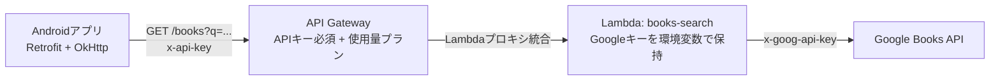
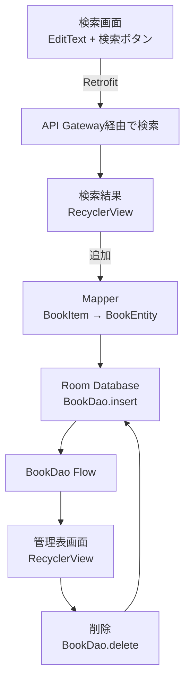

# 書籍管理アプリ(API Gateway + Lambda 経由版)

Google Books APIと連携し、検索した本をローカルDB(Room)に保存して一覧管理するAndroidアプリです。

業務でKotlin・API連携・RecyclerView.Adapterを扱う中で改修作業が多かったため、ゼロから設計〜実装まで通しで経験する学習用途として開発しました。

> **このバージョンについて**
> 初期版では、Google Books APIキーをアプリ内(`BuildConfig`)に保持して直接APIを叩いていました。APKを逆コンパイルするとキーが平文で読み取れる、という既知の問題があったため、本バージョンでは **AWS Lambda + API Gateway 経由**の構成に切り替えています。
>
> **要点:Lambdaで Google のキーは隠せた。しかし入口(API Gateway)は公開のまま。そこで使用量プランで、万一抜かれたときの被害を限定する。**

---

## 目次

- [機能](#機能)
- [技術スタック](#技術スタック)
- [アーキテクチャ](#アーキテクチャ)
- [API仕様](#api仕様)
- [ディレクトリ構成](#ディレクトリ構成)
- [セットアップ](#セットアップ)
- [セキュリティの考え方(Before / After)](#セキュリティの考え方before--after)
- [動作確認・実測結果](#動作確認実測結果)
- [今後の展望](#今後の展望)

---

## 機能

### やること

- 本の管理表(一覧表示)
- 検索(Google Books API) → 選んで追加
- 一覧からの削除

### やらないこと

- 編集機能
- 絞り込み機能
- 手入力での追加(API検索経由のみ)

---

## 技術スタック

| 分類 | 技術 |
|---|---|
| 言語 | Kotlin(Android)/ Java 21(Lambda) |
| UI | RecyclerView, View Binding(`findViewById`) |
| API通信 | Retrofit + OkHttp + Gson |
| ローカルDB | Room(`androidx.room3`、Flow対応版) |
| 非同期処理 | Kotlin Coroutines(`lifecycleScope`, `Flow`) |
| バックエンド | AWS Lambda(Java 21、Gradle Kotlin DSL)、Amazon API Gateway(REST、リージョナル) |
| 外部API | Google Books API(無料) |
| ログ | CloudWatch Logs |

---

## アーキテクチャ

### 全体構成



### アプリ内部の構成



`data`層を`local`(Room)・`remote`(API)・`mapper`(変換)・`repository`(窓口)に分割し、`ui`層からはRepositoryのみを参照する構成にしています。API層とDB層を分離しているため、**接続先をGoogle直叩きからAPI Gatewayに変えた今回の改修も、`remote`層とRepository周辺の変更で収まりました**(変更ファイルは下記)。

### Lambda の責務分離

| クラス | 役割 |
|---|---|
| `BooksHandler` | 入口。入力検証(`q`の空チェック)、ステータスコードの決定 |
| `GoogleBooksClient` | Google Books APIとの通信、レスポンスの変換 |

### 主な設計判断

- **Googleキーはヘッダー(`x-goog-api-key`)で送信**:URLクエリにするとURLがログ等に残りうるため
- **Googleキーの保管は Lambda の環境変数**(暗号化はデフォルトの`aws/lambda`鍵)
- **上流エラーは502に変換**:Googleの4xx/5xx/タイムアウトをまとめて502、キー未設定は500
- **ログにキー・URLは出さない**:ステータスと`reason`のみ記録
- **`maxResults=20`固定**:元実装はパラメータなし(Googleのデフォルト件数)だったため、仕様変更として明示
- **欠落フィールドは欠落のまま返す**:`authors`/`publisher`等を空配列などに正規化しない(アプリ側の「著者不明」表示を維持するため)
- **Lambdaの実行ロールは`AWSLambdaBasicExecutionRole`のみ**:ログ書き込み限定

---

## API仕様

### `GET /books`

| 項目 | 内容 |
|---|---|
| クエリ | `q`(必須。検索キーワード。日本語可) |
| 認証 | ヘッダー `x-api-key` にAPI Gatewayキー |
| レスポンス | Google Books互換の絞り込み形式 |

| ステータス | 条件 |
|---|---|
| 200 | 正常(**0件でも200 + 空配列**) |
| 400 | `q`が空・未指定・空白のみ |
| 403 | `x-api-key`なし/不正(API Gatewayが返す) |
| 429 | 使用量プランのレート/クォータ超過(API Gatewayが返す) |
| 500 | Lambda内部エラー(Googleキー未設定など) |
| 502 | 上流(Google Books API)の4xx/5xx/タイムアウト |

```bash
curl -H "x-api-key: <YOUR_GATEWAY_API_KEY>" \
  "https://<api-id>.execute-api.<region>.amazonaws.com/<stage>/books?q=java"
```

---

## ディレクトリ構成

```text
(リポジトリルート)
├── app/                         ← Androidアプリ
│   └── com.example.myapplication/
│       ├── data/
│       │   ├── local/                  ← Room関連(端末内DB)
│       │   │   ├── BookEntity.kt
│       │   │   ├── BookDao.kt
│       │   │   └── AppDatabase.kt
│       │   ├── remote/                 ← API通信関連
│       │   │   ├── BookApiModel.kt     (BookResponse, BookItem, VolumeInfo, ImageLinks)
│       │   │   ├── ApiService.kt
│       │   │   ├── ApiKeyInterceptor.kt  ← 【新規】x-api-keyを全リクエストに付与
│       │   │   └── RetrofitInstance.kt
│       │   ├── mapper/                 ← API⇔DB間の変換処理
│       │   │   └── BookMapper.kt
│       │   └── repository/             ← Room・APIをまとめる窓口
│       │       └── BookRepository.kt
│       └── ui/
│           ├── list/                   ← 管理表(一覧)画面
│           │   ├── MainActivity.kt
│           │   └── BookListAdapter.kt
│           └── search/                 ← 検索・追加画面
│               ├── SearchActivity.kt
│               └── SearchResultAdapter.kt
│
├── books-lambda/                ← Lambda(Java 21 / Gradle Kotlin DSL)
│   └── BooksHandler / GoogleBooksClient
│
└── docs/
    └── devlog.md                ← 開発記録(問題・原因・解決・学び)
```

### 直叩き版からの変更点(Android側)

| ファイル | 変更内容 |
|---|---|
| `ApiKeyInterceptor.kt`(新規) | 全リクエストに`x-api-key`ヘッダーを自動付与 |
| `RetrofitInstance.kt` | `BASE_URL`をGoogle Books → API Gatewayに変更、Interceptorを追加 |
| `ApiService.kt` | パスを`volumes`→`books`に変更、`apiKey`の`@Query`を削除 |
| `BookRepository.kt` | `searchBooks`から`apiKey`引数を削除 |
| `SearchActivity.kt` | `BuildConfig.GOOGLE_BOOKS_API_KEY`の参照・importを削除 |
| `build.gradle.kts` / `local.properties` | `GATEWAY_API_KEY`の`buildConfigField`を追加 |

---

## セットアップ

動かすには、バックエンド(Lambda + API Gateway)を自分のAWSアカウントに用意する必要があります。

### 1. リポジトリを取得

```bash
git clone <このリポジトリのURL>
cd <リポジトリ名>
```

### 2. バックエンドを用意

**① Google Books APIキーを取得**
[Google Cloud Console](https://console.cloud.google.com/)で、Books APIのみに制限したAPIキーを発行します。このキーは**Lambdaの環境変数にだけ**設定し、アプリには入れません。

**② Lambdaをデプロイ**

```bash
cd books-lambda
./gradlew build
```

1. 関数`books-search`を作成(Java 21、x86_64、512MB、タイムアウト10秒)
2. 環境変数`GOOGLE_BOOKS_API_KEY`にGoogleのキーを設定
3. 実行ロールは`AWSLambdaBasicExecutionRole`のみ

**③ API Gatewayを作成**

1. REST API(リージョナル)を作成
2. `/books`に`GET`を作成し、Lambdaプロキシ統合で`books-search`に接続
3. メソッドで**APIキーを必須化**
4. ステージにデプロイ
5. APIキーと**使用量プラン**(レート5rps / バースト10 / クォータ1000回/日)を作成し、ステージとキーを紐付け

### 3. `local.properties`にGatewayキーを追加

プロジェクトルートの`local.properties`に追記します(Git管理対象外)。

```properties
GATEWAY_API_KEY=<API Gatewayで発行したAPIキー>
```

> **注意**:ここに入れるのはAPI Gatewayのキーです。Googleのキー(`AIza`で始まる)を入れても検索は失敗します。取り違えは「検索が失敗する」という分かりにくい形で表面化するため、追加後に値の形式を目視確認してください。

### 4. `BASE_URL`を変更してビルド・実行

`RetrofitInstance.kt`の`BASE_URL`を、自分のAPI GatewayのURLに変更し、Android Studioで実行します。

---

## セキュリティの考え方(Before / After)

### 何を変えたか

| 観点 | Before(直叩き) | After(Lambda + API Gateway) |
|---|---|---|
| Googleキーの置き場所 | APK内(平文) | Lambda環境変数 |
| アプリが叩く先 | Google Books API | API Gateway |
| APKに入る秘密 | Googleのキー | API Gatewayのキー |
| 被害の上限 | Google側のクォータ任せ | **使用量プランで自前制御** |

`local.properties`はGit管理上の秘匿にはなりますが、ビルド後のAPKの中身は守りません。Before版のAPKをjadxで開くと、`BuildConfig`にGoogleのキーが平文で入っていることを確認しました。

### 守れたもの / 守れていないもの

- **守れた**:Googleキーを APK から排除(リリースビルドをjadxで確認済み)
- **守れていない(前提として受け入れている)**:API Gatewayのキーは依然としてAPKに埋め込まれており、取り出せる。入口は公開のまま

つまり「キーを完全に守る」構成ではなく、「**漏れる前提で、漏れたときの上限を決める**」構成です。

### 使用量プランで被害を限定する

APKから取り出されたキーで大量リクエストを送られても、以下の上限で拒否されます。

| 項目 | 値 |
|---|---|
| レート | 5 rps |
| バースト | 10 |
| クォータ | 1000リクエスト/日 |

### jadxでの確認結果(リリースビルド)

| 項目 | Before | After |
|---|---|---|
| `GOOGLE_BOOKS_API_KEY`の実キー値 | 平文で埋め込み | 埋め込まれていない |
| `GATEWAY_API_KEY` | なし | 埋め込まれている(AWS形式) |
| `BASE_URL` | Google Books API | API Gateway |

> `local.properties`で`GOOGLE_BOOKS_API_KEY`をコメントアウトしただけでは、`buildConfigField`自体は残り、`BuildConfig`に文字列`"null"`として存在し続けます。実キーは含まれず実害はありませんが、「値が空」と「フィールドが存在しない」は別物です(`build.gradle.kts`側のブロック削除は未対応)。

### 今回見送ったもの

アプリ認証、ユーザー単位の認証(Cognito等)、WAFによる制限。個人開発・技術検証の規模を考え、**最小構成(使用量プランのみ)**に留めています。

---

## 動作確認・実測結果

### 画面

- **管理表画面**:タイトル・著者・出版社・出版日の4列で表示。著者情報が無い本は「著者不明」と表示
- **検索画面**:キーワード検索の結果が一覧表示され、「追加」ボタンで管理表に反映

### Lambda / API Gateway のテスト

| パターン | 結果 |
|---|---|
| 通常検索 / 日本語検索 | 200 |
| 検索結果0件 | 200(空配列) |
| `q`が空・null・空白 | 400 |
| 不正なGoogleキー | 502 |
| `x-api-key`なし | 403 |
| `x-api-key`あり | 200 |

---

## 今後の展望

- 横スクロール + 左列固定のテーブル表示(未着手)
- 本の表紙画像表示(未着手)
- (任意)アプリ認証・ユーザー認証・WAFの検討(未着手)